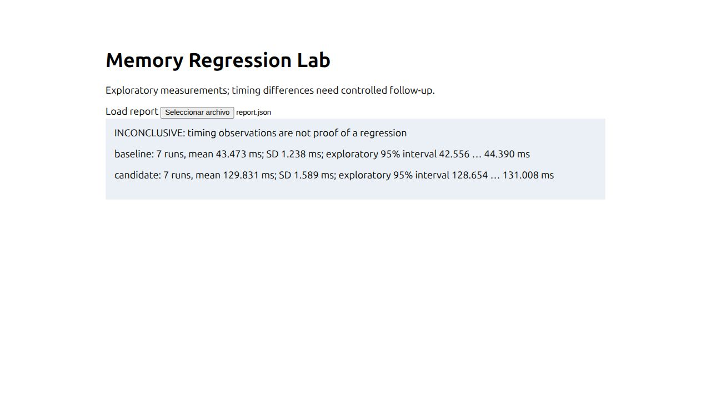

# Memory Regression Lab

Systems developers need to compare fixture memory demand without confusing allocation accounting, RSS and leaks. The Rust orchestrator alternates baseline/candidate order, performs bounded warmups/repeats, measures wall time and exact-child Linux wait4 peak RSS, and reads fixture-provided allocation counters. Rust fixture counts global allocator requests; C++ fixture reports its single explicit allocation. They do not have identical instrumentation scope.

## Architecture, requirements and usage

Rust CLI + small Rust/C++ programs → raw samples/statistics → JSON/Markdown → static JavaScript dashboard. Linux only, Cargo, C++ compiler, Python 3 and Node 18+.

```sh
cargo build --locked
c++ -O1 examples/cpp_fixture.cpp -o target/cpp_fixture
cargo test --locked
python3 tests/functional.py
cargo run --locked --bin memory-regression-lab -- examples/experiment.json results/local-run.json results/local-run.md
node --test tests/dashboard.test.js
python3 -m http.server 8080 --bind 127.0.0.1 --directory web
```

Open the dashboard and select results/report.json. Fixture changes from 4 to 12 MiB; checksum remains 2 while instrumented requested bytes increase. Actual timing and RSS are observations and are never deterministic acceptance thresholds. Report includes n, mean, median, sample SD, min/max and exploratory normal mean/paired intervals. Verdict remains INCONCLUSIVE.

## Limitations, security and portfolio value

No leak detector, allocation stack tracing or automatic regression declaration. Peak RSS includes executable/allocator effects. Small-sample normal intervals can under-cover; there is no multiple-testing correction. Child wall time includes process start, polling and scheduling overhead. Trusted single-process programs only: stdout bounded to 64 KiB, virtual memory capped at 512 MiB, timeout at 2 seconds, repeats at 30. Descendant processes are outside supported profile. Optional sanitizers are not integrated. CI functional checks do not assert performance. Business value is transparent raw evidence and metric separation, rather than a profiler replacement.

## Verification and publication

Evidence labels: VERIFIED = checked against a stated criterion; OBSERVED = measured execution; INFERRED = interpretation; HYPOTHESIS = proposed explanation; NOT_VERIFIED = missing evidence. Local status and executed commands are in `results/validation.json` and `docs/REVIEW.md`. Synthetic validation establishes implementation behavior, not production accuracy.

This is an independent Git repository with original MIT project code. Publication-gate evidence is in `results/publication-gate-20261012.json` and `docs/PUBLICATION_REVIEW.md`. The original local-delivery records are retained as historical evidence. CI uses public dependency registries and requires no secrets. See `docs/PROVENANCE.md` for dependency and advisory review scope.

## License

MIT; see LICENSE.



Local C++ validation used a hash-checked Ubuntu g++-13 compiler package extracted under ignored toolchain/ and host GCC/runtime. This project did not install system packages. See results/validation.json for exact local commands.

## Reproducing development checks

Optional public-registry dependency review: `python3 tools/dependency_audit.py .` writes `results/dependency-audit.json`. This developer check uses the free OSV API and is separate from offline application execution. Zero listed advisories does not prove absence of vulnerabilities. License evidence is in results/licenses.json and, for scientific projects, results/python-licenses.json.

Install `requirements-dev.txt` to run the recorded Ruff 0.17.0 source checks. Commands, actual versions, failed attempts, review corrections and measured peak RSS are retained in results/validation.json, results/tool-versions.json and docs/REVIEW.md. Check the GitHub Actions run for the exact commit before claiming hosted CI success; older local-delivery records retain their as-of NOT_VERIFIED status.

Evidence preservation: choose distinct fresh output paths for each execution. Existing report files reject before measurement, and create_new prevents replacement races. The shipped results/report.json is the current fully retained seven-pair experiment. An earlier inconclusive run was superseded before raw samples were archived; its rounded observed aggregates and explicit NOT_VERIFIED raw-sample gap are preserved in results/legacy-run-aggregate.json. No historical raw measurements were reconstructed.

Output parents must exist. Parent-directory canonicalization detects relative/directory aliases before measurement. JSON and Markdown are created sequentially rather than as an atomic pair; a write failure may leave a new partial pair with a failing CLI status. Existing evidence remains protected by exclusive creation.
